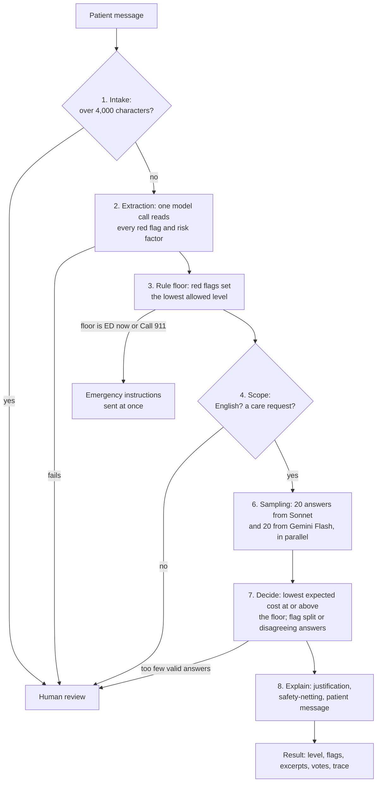

# Disposition agent

This agent reads one asynchronous patient message and picks one of seven
urgency levels, from Call 911 to Self-care, with a justification a physician
can check against the patient's own words. It never routes an emergency
lower than its safety rules allow, and anything it is unsure of goes to a
physician (Human review).

- **Live demo (synthetic messages only):**
  <https://counsel-disposition-web.counsel-demo.workers.dev>
- **Design docs:** [architecture](docs/architecture.md),
  [policy](docs/policy.md), [eval](docs/eval.md),
  [decisions](docs/decisions.md),
  [reliability roadmap](docs/reliability-roadmap.md),
  [rate limits](docs/rate-limits.md)

## How it works

A Cloudflare Worker runs every message through the same steps. The demo and
the Python eval both call this one Worker, so the demo shows exactly what
the eval measures.



Step 5 is a floor-only exit that the eval uses as a baseline. Every failure
ends at Human review. If the floor was already ED now or Call 911, Human
review keeps it, so a failure never lowers an emergency.
[Architecture](docs/architecture.md) has the detail.

## Results

From [the policy 0.1.0 report](reports/2026-11-04-policy-0.1.0.md): 50
cases reviewed blind by a physician, 14 of them emergencies (Call 911 or
ED now). Aggregate numbers only.

<!-- RERUN: the full-agent row comes from run 2 (2026-11-04 15:55 UTC),
before the stricter extraction rule. Update it from the 50-case rerun. -->

| System | Missed emergencies | Human review | Cost score (lower is better) |
|---|---|---|---|
| **Full agent** (Sonnet + Flash) | **0 of 14** | **12%** | **0.80** |
| Rule floor only | 0 of 14 | 0% | 1.19 |
| Always escalate to ED | 0 of 14 | 0% | 2.52 |
| Historical dispositions | 4 of 14 | 0% | 4.12 |

<!-- /RERUN -->

The cost score is the average cost of each routing mistake, weighted so
under-triage costs more than over-triage, plus 0.2 for every case flagged
for a physician. With 14 emergencies, 0 misses still allows a true miss
rate of up to 23% (95% confidence). [Eval](docs/eval.md) explains the
metrics, the other conditions tested and their limits.

## Run it

Needs Node 22 and [uv](https://docs.astral.sh/uv/) with Python 3.11.

```sh
# Tests (hermetic: every model call is mocked)
cd worker && npm ci && npm test && cd ..
node --test 'web/test/*.test.mjs'
cd eval && uv sync && uv run pytest && cd ..

# The Worker locally. worker/.dev.vars (gitignored) holds
# OPENROUTER_API_KEY=... and ACCESS_TOKEN=...
cd worker && npm run build-policy && npx wrangler dev

# The eval against it (needs Counsel's cases in data/private/)
cd eval && COUNSEL_TOKEN=... uv run counsel-eval --url http://localhost:8787
```

## Data notice

Counsel's patient messages and labels are not in this repo and never will
be. The eval reads them from a local, gitignored folder, and committed
reports hold aggregate numbers only. Every message in the demo was written
for this project and is synthetic. The demo is not medical advice. Logs
never contain message text or IP addresses.
